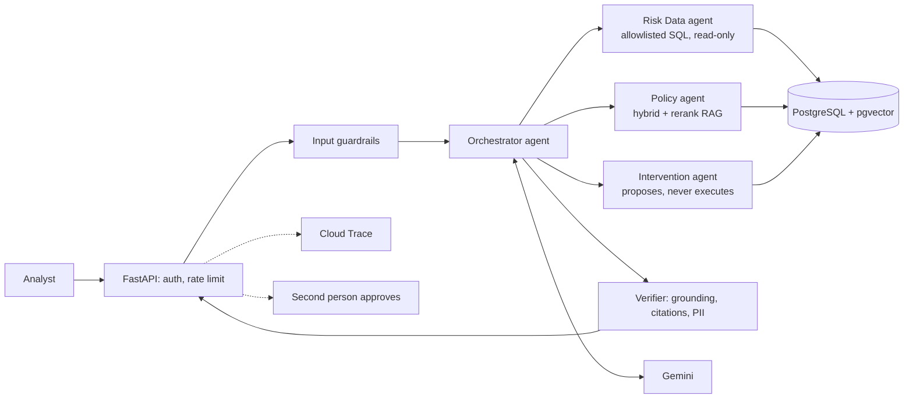
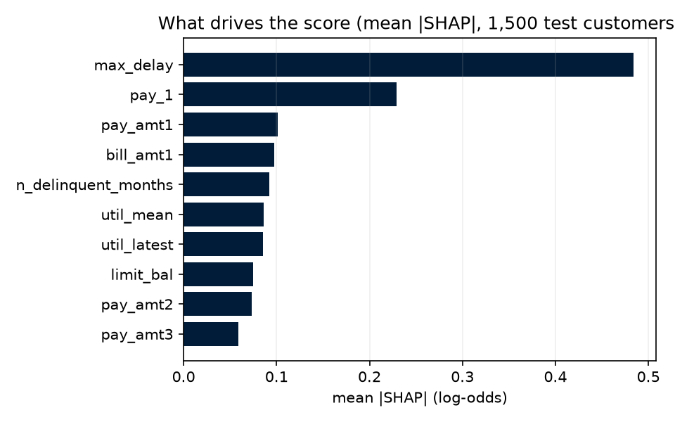

# Drishti

Credit-default early warning with an AI copilot for risk analysts.

Drishti scores card-holders for default risk, explains each score, and answers analysts' questions in plain language
using both the customer data and the lending-policy text (RBI directions). When it recommends an action (for example an
EMI extension or a restructuring review), the recommendation cites the policy paragraph it relies on and waits for a
second person to approve it. The system never executes an action itself.


## Features

* **Risk scoring**: a gradient-boosted classifier (XGBoost, scikit-learn) with calibrated probabilities, risk segments
  (CRITICAL / HIGH / MEDIUM / LOW) and per-customer SHAP explanations.
* **Early-warning API**: FastAPI endpoints for scoring, ranked at-risk lists, customer detail and interventions.
* **Copilot**: a Google ADK agent team (orchestrator, risk-data, policy and intervention agents) with a verifier that
  checks answers against the evidence and masks personal data.
* **Policy search**: hybrid retrieval (vectors in pgvector, BM25, reciprocal-rank fusion, reranking) over RBI
  directions, with chapter / topic / paragraph citations.
* **Human approval**: recommendations are stored as `proposed` and must be approved by someone other than the proposer.
* **Observability**: OpenTelemetry traces (Cloud Trace), per-request tokens, tokens/sec, latency and cost, JSON logs.
* **Evaluation**: a golden question set, retrieval metrics, safety tests and a baseline-vs-final comparison, runnable in CI.
* **Interfaces**: Streamlit console and the React dashboard (with a Copilot page).

## Architecture



Design notes and trade-offs: [docs/ARCHITECTURE.md](docs/ARCHITECTURE.md).

## Quickstart

Requires Python 3.11+. No Docker needed locally (SQLite is used when no Postgres URL is set).

```bash
make setup      # virtualenv + pinned dependencies
make all        # dataset -> model -> score customers -> fetch + ingest policy corpus -> evaluations
make doctor     # shows what is configured, what is missing and how to fix it
make api        # API on http://localhost:8000
make ui         # Streamlit console on http://localhost:8501
```

Create an API key (stored only as a hash) and call the API:

```bash
python -m drishti.api.auth me admin            # prints the key once
curl -H "X-API-Key: <key>" "localhost:8000/early-warning?segment=CRITICAL&limit=5"
```

React dashboard: `cd dashboard && npm install && npm run dev` (v1 pages use the Express backend in `dashboard/server`;
the Copilot page talks to this API).

### Turning on the LLM features

Chat, the reranker, Gemini embeddings and the LLM-based evaluations need Gemini access. Put one of these in
[`secrets/`](secrets/README.md) (git-ignored); Drishti detects it automatically:

* `secrets/.env` containing `GOOGLE_API_KEY=...` (Gemini API), or
* `secrets/gcp-service-account.json` (Vertex AI).

Without credentials, scoring, the API, retrieval and the deterministic evaluations still run.

## API

| Endpoint | Purpose |
|---|---|
| `POST /chat` | Ask the copilot (supports `stream: true`); returns answer, citations, trace id, metrics |
| `GET /sessions/{id}` | Conversation history |
| `POST /predict` | Score one customer from raw monthly data |
| `GET /early-warning?segment=` | Customers in a risk segment, highest risk first |
| `GET /api/customers`, `/api/customers/{id}`, `/api/stats` | Customer list and detail (v1-compatible shapes) |
| `GET/POST /interventions`, `POST /interventions/{id}/decision` | Proposed actions and approvals |
| `GET /admin/metrics`, `/admin/metrics/recent`, `/admin/model` | Latency / cost summary and model card |
| `GET /health` | Liveness |

Errors are JSON with a code, message and trace id. All endpoints except `/health` need `X-API-Key` (or Google IAP).

## Model

The model is trained on the public UCI *Default of Credit Card Clients* dataset (30,000 records) with a fixed
60/20/20 stratified split; model selection and calibration use validation data and the test split is scored once
(`models/metrics.json`).

| Operating point | Precision | Recall | F1 | Flagged (of 6,000) |
|---|---|---|---|---|
| Balanced (max F1) | 0.501 | 0.612 | 0.551 | 1,620 |
| Strict | 0.900 | 0.034 | 0.065 | 50 |

ROC-AUC 0.790, PR-AUC 0.559 for the gradient-boosting model currently committed. Precision depends on the threshold,
so use the precision/recall trade-off above rather than a single number. XGBoost is included as a candidate and is
selected automatically whenever it loads and wins on validation.

**Bringing your own model** (for example from a notebook): export it to `models/incoming/` and run
`python -m drishti.ml.import_model --load`. The importer validates it, calibrates it, evaluates it on the held-out split
and re-scores every customer. See [docs/MODEL_CONTRACT.md](docs/MODEL_CONTRACT.md) and
[`notebooks/xgboost_model_template.ipynb`](notebooks/xgboost_model_template.ipynb).

<p> </p>

## Policy corpus and retrieval

`python -m ingest fetch` downloads five public RBI directions (NBFC responsible business conduct, NBFC and bank
resolution of stressed assets, NBFC and bank credit-card conduct) with title, URL, date and hash recorded in
[`data/policies/SOURCES.md`](data/policies/SOURCES.md). `python -m ingest run` splits them by chapter / topic / paragraph,
embeds them and stores them in pgvector (810 chunks). Ingestion is idempotent. Add more documents by placing PDFs or text
files in `data/policies/`.

Retrieval quality on the golden policy questions (k = 5, offline embedder and lexical reranker):

| Configuration | recall@5 | MRR |
|---|---|---|
| Vector only | 0.588 | 0.392 |
| + BM25 with rank fusion | 0.765 | 0.649 |
| + reranking | 0.824 | 0.698 |

## Evaluation

`evals/` holds a 59-question golden set (data questions checked against live SQL, policy questions, intervention
scenarios and adversarial prompts) and a harness (`python -m evals.run`) that reports accuracy, groundedness, citation
precision, recall@k / MRR, safety pass rate, latency, tokens/sec and cost per request for a baseline (single agent,
vector-only retrieval) and the final system. Results are written to [`evals/results/RESULTS.md`](evals/results/RESULTS.md).
`make eval-offline` needs no credentials; `make all` or the **eval** GitHub workflow run the LLM-based part once Gemini
credentials are configured.

## Deployment

* Terraform: [`deploy/terraform/`](deploy/terraform/README.md) (Cloud Run, Cloud SQL with pgvector, Secret Manager,
  Artifact Registry, IAM, budget alert), or `bash deploy/deploy.sh`.
* Docker: multi-stage, non-root image; the model is built (or imported from `models/incoming/`) during the build.
  `docker compose up` runs API, UI and Postgres locally.
* GitHub Actions: `ci` on every PR, manual `eval` and `deploy` workflows.
* Post-deploy smoke test: `make smoke URL=... KEY=...`.

## Development

```bash
make test        # pytest with coverage
make lint        # ruff
make typecheck   # mypy
```

CI also runs the pgvector/Postgres integration tests, the Docker build, `terraform validate`, shellcheck and the
dashboard lint and build. Contribution workflow and the split between app and model work: [CONTRIBUTING.md](CONTRIBUTING.md).

## Project layout

```
drishti/       api/ · agents/ · ml/ · rag/ · db/ · obs/
ingest/        policy corpus: fetch, parse, chunk, embed, store
evals/         golden set, harness, results
benchmarks/    timed manual-vs-assisted review harness
notebooks/     model notebooks (XGBoost template)
models/        metrics.json; incoming/ for imported models
migrations/    PostgreSQL schema, pgvector tables, read-only role
deploy/        Terraform and gcloud scripts      scripts/  quickstart, smoke test
ui/            Streamlit console                 dashboard/  React dashboard (v1 pages + Copilot page)
secrets/       local credentials (git-ignored)   docs/      architecture, model contract, discovery notes
tests/         pytest suite
```

## Status and known limitations

* The model is trained on a public dataset (Taiwan, 2005), not a lender's portfolio; retrain on your own data before use.
* LLM-dependent results (answer accuracy, latency, cost) appear in `RESULTS.md` after the first run with credentials.
* Customer-level scores in the loaded database include rows the model trained on; evaluation metrics use the held-out
  split only.
* A cloud deployment has not been run yet; the Terraform and scripts are validated in CI.
* The v1 React pages in `dashboard/` use synthetic data from their own Express backend.
