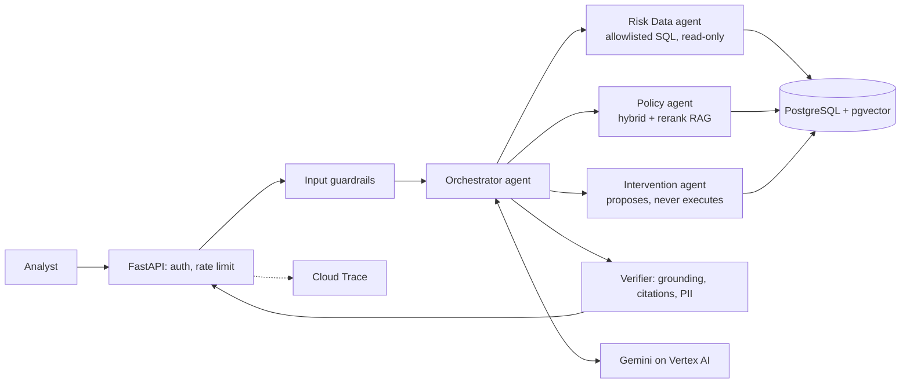

# Drishti: credit-default early warning with a multi-agent policy copilot

Drishti flags card-holders likely to default, explains why, and helps a risk analyst decide what to do next. A **scikit-learn** model scores customers; a **FastAPI** service exposes scoring and a chat copilot; a hierarchy of **Google ADK** agents (orchestrator → risk-data, policy-RAG, intervention, plus a verifier stage) answers questions over customer data and lending-policy documents with **citations**. Every proposed action (EMI extension, restructuring review, counselling referral) is tied to a policy clause and **requires human approval**. The system never executes anything. It runs on **Gemini via Vertex AI**, stores structured data and vectors in **PostgreSQL + pgvector**, traces with **OpenTelemetry → Cloud Trace**, and deploys to **Cloud Run**.

## Tech stack

| Layer | Technology |
|---|---|
| Language | Python 3.11+ (developed on 3.14) |
| ML | scikit-learn (HistGradientBoosting + logistic baseline, isotonic calibration), pandas, NumPy |
| API | FastAPI, Pydantic v2, SQLAlchemy 2, slowapi rate limiting, hashed API keys / IAP |
| Agents | Google ADK 2.x, Gemini (Vertex AI), ReAct tool loops, hierarchical delegation via `AgentTool` |
| RAG | pypdf, structure-aware chunking, Vertex AI embeddings, **pgvector (HNSW)**, BM25, reciprocal rank fusion, reranking |
| Data | PostgreSQL / Cloud SQL (SQLite for zero-setup local runs) |
| Observability | OpenTelemetry (console / OTLP / Cloud Trace), per-request tokens, tokens/s, latency, cost |
| Evaluation | Golden set (59 q), oracle-checked SQL, recall@k / MRR, LLM-as-judge rubric, ablation, CI regression gate |
| Quality | pytest (+ coverage), ruff, mypy, pre-commit, GitHub Actions |
| Deploy | Docker multi-stage (non-root), Docker Compose, Cloud Run, Secret Manager, `gcloud` scripts |
| UI | Streamlit admin console |
| Legacy | React 19 + Vite + Express dashboard from v1, kept in [`dashboard/`](dashboard/) |

## Architecture



Full diagram, request flow and design trade-offs: [docs/ARCHITECTURE.md](docs/ARCHITECTURE.md).

## What it can answer

* "Which 10 customers are most at risk this month and why?"
* "What can we offer customer #4521 under our policies?" → a proposed action with cited clauses, pending approval
* "Is a 10-day EMI extension allowed for a customer with two missed payments?" → a cited answer, or an explicit "the corpus doesn't cover this"
* Multi-turn: "Now draft a counselling note for the top 3." (conversation state persists in Postgres-backed ADK sessions)

## Quickstart (local, no Docker, about 5 minutes)

```bash
make setup            # venv + pinned dependencies
make data train load  # download the public dataset, train + evaluate the model, score and load 30,000 customers
python -m drishti.api.auth me admin   # prints an API key once (only its hash is stored)
make api              # FastAPI on :8000
curl -H "X-API-Key: <key>" "localhost:8000/early-warning?segment=CRITICAL&limit=5"
```
For the chat copilot, point at Vertex AI (`GOOGLE_CLOUD_PROJECT`, `GOOGLE_CLOUD_LOCATION`, application-default credentials) in `.env`, add the policy PDFs listed in [data/policies/SOURCES.md](data/policies/SOURCES.md), then:
```bash
make ingest           # parse -> chunk -> embed -> store (idempotent)
make ui               # Streamlit console on :8501
```
Full stack with Postgres + pgvector: `make up`. Tests: `make test`. Offline eval: `make eval-offline`.

## Model: what it actually achieves

Trained on the public UCI *Default of Credit Card Clients* dataset (30,000 real records), stratified 60/20/20 split, selection and calibration on validation, reported once on the held-out test set. From [`models/metrics.json`](models/metrics.json):

| Operating point | Precision | Recall | F1 | Customers flagged (of 6,000) |
|---|---|---|---|---|
| Max-F1 threshold | 0.501 | 0.612 | 0.551 | 1,620 |
| Strict threshold | 0.900 | 0.034 | 0.065 | 50 |

ROC-AUC 0.790, PR-AUC 0.559. Precision depends heavily on how many customers you are willing to flag, so quote the operating point, not a single number.

## Evaluation

[`evals/`](evals/) holds a 59-question golden set (20 SQL/data, 17 policy RAG, 8 intervention, 14 adversarial). SQL answers are checked against oracle queries run on the live database; policy questions use topic keywords and need their reference answers reviewed once the RBI PDFs are ingested; safety questions check refusal and non-leakage. `python -m evals.run` measures answer accuracy, groundedness, recall@k / MRR, safety pass rate, latency p50/p95, tokens/s and cost per request, and runs a **baseline vs final** ablation (single flat agent + vector-only retrieval + no verifier, against orchestrator + hybrid/rerank + verifier). `RESULTS.md` is generated by the script. A regression mode fails CI when thresholds drop.

**Status:** the offline portion has been run (see [evals/results/RESULTS.md](evals/results/RESULTS.md)): 12/13 non-poisoned adversarial prompts are blocked before reaching a model, and all 17 oracle queries execute. The end-to-end baseline-vs-final comparison needs Vertex AI credentials and the policy PDFs and is **not yet run**, so the table in `RESULTS.md` shows "not run" rather than numbers. See [evals/ERROR_ANALYSIS.md](evals/ERROR_ANALYSIS.md).

## Security and safety

* **No free-form SQL**: agents call 7 named, parameterised queries over a read-only connection; the ground-truth label column is unreachable.
* **Human approval**: the single write tool only inserts `proposed` recommendations; approval is an authenticated API call.
* **Guardrails**: jailbreak / bulk-PII / destructive / out-of-scope refusal before any model call, prompt-injection scrubbing on retrieved text, citation and number-provenance verification, PII masking in answers, logs and traces.
* **API**: hashed keys (or Google IAP), rate limiting, strict Pydantic validation, structured errors with trace ids, no stack traces in responses, secrets in Secret Manager, least-privilege service account, non-root container.

## Project layout

```
drishti/        core package: api/, agents/ (system, tools, guardrails, verifier), ml/, rag/, db/, obs/
ingest/         python -m ingest run   (PDF → chunks → embeddings → pgvector)
evals/          golden set, harness, rubric, results, error analysis
ui/             Streamlit admin console
deploy/         Cloud Run deploy / teardown scripts
docs/           CLAIMS_AUDIT, DISCOVERY, ARCHITECTURE, FIELD_FEEDBACK
dashboard/      original React dashboard (v1)
tests/          pytest suite (66 tests)
```

## Documentation

* [docs/DISCOVERY.md](docs/DISCOVERY.md): technical discovery write-up for a lending client (stakeholders, workflow, constraints, metrics, rollout)
* [docs/ARCHITECTURE.md](docs/ARCHITECTURE.md): diagram, design decisions and trade-offs
* [docs/FIELD_FEEDBACK.md](docs/FIELD_FEEDBACK.md): feature requests and reusable modules
* [docs/CLAIMS_AUDIT.md](docs/CLAIMS_AUDIT.md): audit of v1 against the original project description
* [RESUME_FACTS.md](RESUME_FACTS.md): every quotable number with the command that reproduces it

## Honest status

| Done and verified locally | Written, not yet run |
|---|---|
| Model training and held-out metrics, 30k customers loaded, API (auth, early warning, approvals), SQL allowlist, guardrails, verifier, ingestion + retrieval (on test fixtures), agent routing with a mocked LLM, 66 tests, ruff + mypy clean, offline eval | Live Gemini calls (chat, judge, Vertex embeddings), the policy corpus (PDFs need to be added), end-to-end baseline vs final evaluation, pgvector store against a real Postgres, Docker image, Cloud Run deployment |

The original v1 (React + Express + SQLite on 1,000 synthetic customers) lives in [`dashboard/`](dashboard/); see [dashboard/README.legacy.md](dashboard/README.legacy.md).
