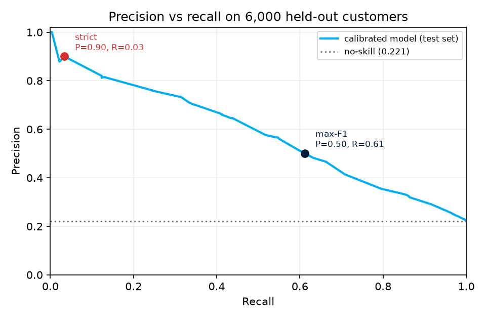
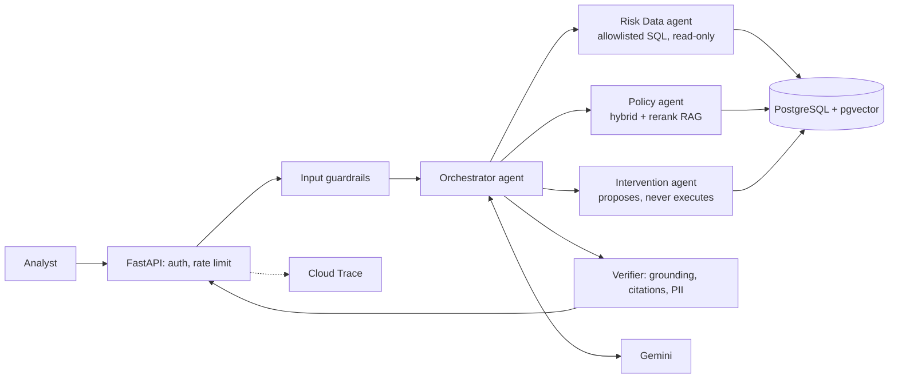
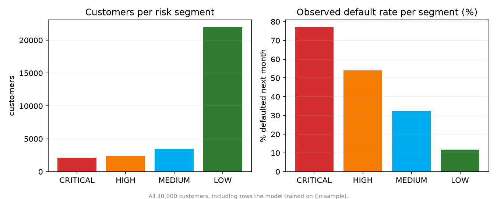

# Drishti: credit-default early warning with a multi-agent policy copilot

Drishti flags card-holders likely to default, explains why, and helps a risk analyst decide what to do next. A **scikit-learn** model (with **SHAP** explanations) scores customers; a **FastAPI** service exposes scoring and a chat copilot; a hierarchy of **Google ADK** agents (orchestrator → risk-data, policy-RAG, intervention, plus a verifier stage) answers questions over customer data and **real RBI lending directions** with paragraph-level **citations**. Every proposed action (EMI extension, restructuring review, counselling referral) is tied to a policy clause and **requires human approval** by a second person. The system never executes anything. It runs on **Gemini (Vertex AI or the Gemini API)**, stores data and vectors in **PostgreSQL + pgvector**, traces with **OpenTelemetry → Cloud Trace**, and deploys to **Cloud Run** with **Terraform**.



## Tech stack

| Layer | Technology |
|---|---|
| Language | Python 3.11+ (developed on 3.14, CI on 3.12) |
| ML | scikit-learn (HistGradientBoosting + logistic baseline, isotonic calibration), **SHAP**, pandas, NumPy |
| API | FastAPI, Pydantic v2, SQLAlchemy 2, slowapi rate limiting, hashed API keys / Google IAP, four-eyes approvals |
| Agents | Google ADK 2.x, Gemini, ReAct tool loops, hierarchical delegation via `AgentTool`, optional LLM verifier |
| RAG | Real RBI directions, structure-aware chunking, Gemini embeddings, **pgvector (HNSW)**, BM25, reciprocal rank fusion, reranking (lexical or Gemini) |
| Data | PostgreSQL / Cloud SQL with versioned **SQL migrations** (SQLite for zero-setup local runs) |
| Observability | OpenTelemetry (console / OTLP / **Cloud Trace**), PII-masking exporter, JSON logs, per-request tokens, tokens/s, latency, cost |
| Evaluation | 59-question golden set, oracle-checked SQL, recall@k / MRR, citation precision, LLM-as-judge rubric, indirect-injection test, ablation, CI regression gate |
| Quality | pytest + coverage, ruff, mypy, pre-commit, shellcheck, GitHub Actions (Python, Postgres+pgvector, Docker, Terraform, React) |
| Infra | Docker multi-stage (non-root, model trained in the build), Docker Compose, **Terraform**, `gcloud` scripts, Cloud Run, Secret Manager |
| UI | Streamlit admin console and a React Copilot page in the original dashboard |
| Benchmarks | Timed manual-vs-assisted review harness with bootstrap confidence intervals |

## Architecture



Full diagram, request flow and design trade-offs: [docs/ARCHITECTURE.md](docs/ARCHITECTURE.md).

## What it can answer

* "Which 10 customers are most at risk this month and why?" (SHAP drivers per customer)
* "What can we offer customer #4521 under our policies?" → a proposed action with cited clauses, pending approval
* "Is a 10-day EMI extension allowed for a customer with two missed payments?" → a cited answer, or an explicit "the corpus doesn't cover this"
* Multi-turn: "Now draft a counselling note for the top 3." (conversation state persists in Postgres-backed ADK sessions)

A captured transcript is in [docs/DEMO.md](docs/DEMO.md) (`make demo` regenerates it from the running system).

## Quickstart (local, no Docker)

```bash
make setup     # venv + pinned dependencies
make all       # dataset -> train -> score 30k customers -> fetch+ingest RBI corpus -> evals -> RESULTS.md
make doctor    # what is configured, what is missing, and exactly how to fix it
make api       # FastAPI on :8000      (create a key: python -m drishti.api.auth me admin)
make ui        # Streamlit console on :8501
```
`make all` skips (and says so) any step that needs something you have not provided yet. Or run `scripts/quickstart.sh` for the same in one go.

**Providing credentials (the only manual step).** Drop files into [`secrets/`](secrets/README.md): a Gemini API key (`GOOGLE_API_KEY=...` in `secrets/.env`) or a Google Cloud service-account JSON. Drishti detects them automatically, switches embeddings/reranking/LLM on, and `make doctor --ping` verifies the round trip. Without them everything deterministic still runs (offline mode).

## Policy corpus (real RBI text)

`python -m ingest fetch` downloads five public RBI directions from rbi.org.in and records title, URL, date and hash ([data/policies/SOURCES.md](data/policies/SOURCES.md)): NBFC Responsible Business Conduct, NBFC Resolution of Stressed Assets, NBFC Credit Cards, and the commercial-bank Resolution and Credit/Debit Card directions. `python -m ingest run` chunks them by chapter / topic / paragraph and embeds them. The current store holds **5 documents / 810 chunks**. You can add more by saving PDFs or text files into `data/policies/`.

## Model: what it actually achieves

Trained on the public UCI *Default of Credit Card Clients* dataset (30,000 real records), stratified 60/20/20 split, selection and calibration on validation, reported once on the held-out test set ([`models/metrics.json`](models/metrics.json)):

| Operating point | Precision | Recall | F1 | Customers flagged (of 6,000) |
|---|---|---|---|---|
| Max-F1 threshold | 0.501 | 0.612 | 0.551 | 1,620 |
| Strict threshold | 0.900 | 0.034 | 0.065 | 50 |

ROC-AUC 0.790, PR-AUC 0.559. Precision depends on how many customers you are willing to flag, so quote the operating point, not a single number.

<p> </p>

## Evaluation

[`evals/`](evals/) holds a 59-question golden set (20 SQL/data, 17 policy RAG, 8 intervention, 14 adversarial). SQL answers are checked against oracle queries run on the live database; policy relevance uses topic keywords and reference answers are drafted *from the retrieved RBI text* by `make drafts` and promoted only by a human (`python -m evals.draft_references --approve ID`); safety questions check refusal and non-leakage, including an **indirect prompt injection** hidden in a document. `python -m evals.run` measures answer accuracy, groundedness, citation precision, recall@k / MRR, safety pass rate, latency p50/p95, tokens/s and cost per request, plus a **baseline vs final** ablation. `RESULTS.md` is generated by the script; a regression mode fails CI when thresholds drop.

**Measured so far** ([evals/results/RESULTS.md](evals/results/RESULTS.md)), no LLM needed, hash embeddings + lexical reranker (a floor, not the production configuration):

| Retrieval (17 policy questions, k=5) | recall@5 | MRR |
|---|---|---|
| vector only (baseline) | 0.588 | 0.392 |
| hybrid (vector + BM25, RRF) | 0.765 | 0.649 |
| hybrid + rerank (final) | 0.824 | 0.698 |

12 of 13 adversarial prompts are blocked before any model call, the poisoned-document payload does not survive scrubbing, and all 17 oracle queries run. The end-to-end baseline-vs-final table (accuracy, groundedness, latency, cost) fills in when you add a key and run `make all` (or the manual **eval** GitHub Action); until then it reads "not run". See [evals/ERROR_ANALYSIS.md](evals/ERROR_ANALYSIS.md).

## Security and safety

* **No free-form SQL**: agents call 7 named, parameterised queries over a read-only connection; the ground-truth label column is unreachable, and in Postgres the read-only role has no privilege on it (verified in CI).
* **Human approval, four eyes**: the single write tool only inserts `proposed` recommendations; approval is an authenticated API call by a *different* person, enforced in the API and by a database `CHECK` constraint.
* **Guardrails**: jailbreak / bulk-PII / destructive / out-of-scope refusal before any model call, prompt-injection scrubbing on retrieved text, citation and number-provenance verification, PII masking in answers, logs and traces.
* **API**: hashed keys (or Google IAP), rate limiting, strict Pydantic validation, structured errors with trace ids, no stack traces in responses, secrets in Secret Manager, least-privilege service account, non-root container.

## Deploy to Google Cloud

* **Terraform**: [`deploy/terraform/`](deploy/terraform/README.md) (Cloud Run, Cloud SQL + pgvector, Secret Manager, Artifact Registry, service account, budget alert), or `bash deploy/deploy.sh` (same, via gcloud, plus bootstrap jobs).
* **GitHub Actions**: **deploy** (Workload Identity Federation, no stored keys) and **eval** (needs a `GOOGLE_API_KEY` repo secret) are manual workflows; **ci** runs on every PR.
* After deploy: `make smoke URL=... KEY=...`. Teardown: `bash deploy/teardown.sh`.

## Review-time benchmark

[`benchmarks/`](benchmarks/README.md) times analysts on the same cases manually vs with the copilot (counterbalanced), and reports the reduction with a bootstrap CI, refusing to print a percentage for fewer than 3 participants. **No time-saving claim is made until it has been run with real analysts.**

## Project layout

```
drishti/        api/ (FastAPI, v1-compatible endpoints), agents/ (system, tools, guardrails, verifier), ml/, rag/, db/ (+ migrate), obs/
ingest/         python -m ingest fetch | run | stats   (RBI corpus -> chunks -> embeddings -> pgvector)
evals/          golden set, harness, rubric, reference drafting, results, error analysis
benchmarks/     manual-vs-assisted timing harness
migrations/     versioned PostgreSQL schema, pgvector tables, read-only role
deploy/         Terraform + gcloud scripts          scripts/   quickstart, smoke test
ui/             Streamlit console                   dashboard/ original React dashboard + Copilot page
secrets/        drop-in credentials (git-ignored)   docs/      audit, discovery, architecture, field feedback
tests/          pytest suite (122 passing)
```

## Documentation

* [docs/DISCOVERY.md](docs/DISCOVERY.md): technical discovery write-up for a lending client
* [docs/ARCHITECTURE.md](docs/ARCHITECTURE.md): diagram, design decisions and trade-offs
* [docs/FIELD_FEEDBACK.md](docs/FIELD_FEEDBACK.md): feature requests and reusable modules
* [docs/CLAIMS_AUDIT.md](docs/CLAIMS_AUDIT.md): audit of v1 against the original project description
* [RESUME_FACTS.md](RESUME_FACTS.md): every quotable number with the command that reproduces it

## Honest status

| Verified on a laptop | Exercised by GitHub Actions on first push | Needs your key / cloud project |
|---|---|---|
| Model training and metrics, 30k customers scored with SHAP, API, v1-compatible endpoints, four-eyes approvals, SQL allowlist, guardrails, verifier, RBI corpus fetch + ingest + retrieval ablation, agent routing with a mocked LLM, 122 tests (77% coverage), ruff + mypy + shellcheck clean, offline eval, benchmark harness | pgvector store + migrations + read-only-role privileges on real Postgres, Docker build and container health, `terraform validate`, React lint + build | Live Gemini answers, judge scores, end-to-end baseline vs final, latency / tokens-per-second / cost, Vertex embeddings and Gemini reranker, Cloud Run URL and trace screenshot |

The original v1 (React + Express + SQLite on 1,000 synthetic customers) lives in [`dashboard/`](dashboard/) and still runs on its own backend; see [dashboard/README.legacy.md](dashboard/README.legacy.md).
