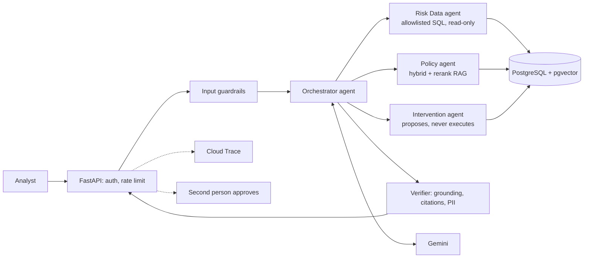

<div align="center">

# 👁️ Drishti

### See default risk coming. Know what you're allowed to do about it.

An AI copilot for credit-risk teams: it scores customers, explains the score, reads the regulator's own directions, and
recommends the next step with the exact paragraph it relies on. A second human approves. The system never acts on its own.

[](https://github.com/pr1t4m-d3y/Drishti/actions/workflows/ci.yml)


</div>

*Drishti* (दृष्टि) means "sight". The numbers in the badges above are read live from
[`models/metrics.json`](models/metrics.json): they are measured on a held-out test split, so they always match the
model that is currently committed.

---

## ✨ Why it exists

Risk teams usually see a default after it happens. Then they dig through several systems and a pile of circulars to find
out what they may offer. Drishti closes that gap:

| | |
|---|---|
| 📈 **Spot it early** | A calibrated model ranks every customer by default risk and puts them in CRITICAL / HIGH / MEDIUM / LOW. |
| 🔍 **Understand it** | SHAP explains each score in terms of the customer's own repayment history. |
| 📜 **Know the rules** | A policy agent searches RBI directions and answers with chapter / topic / paragraph citations. |
| 🤝 **Decide with a human** | Every recommendation is stored as `proposed` and must be approved by someone other than the proposer. |
| 🛡️ **Safe by design** | Read-only data access, allow-listed queries, prompt-injection scrubbing, PII masking, answer verification. |


## 🧠 What's inside

* **Risk model**: gradient-boosted classifiers (XGBoost, scikit-learn) with calibrated probabilities, cost-aware
  thresholds and per-customer SHAP drivers. Bring your own model from a notebook with one command.
* **Agent team** (Google ADK): an orchestrator delegating to risk-data, policy and intervention specialists, each running
  a reason → act → observe loop, followed by a verifier that checks every answer against the evidence.
* **Policy RAG**: hybrid search (pgvector + BM25 + reciprocal-rank fusion + reranking) over real RBI directions.
* **Early-warning API** (FastAPI): scoring, ranked at-risk lists, customer detail, streaming chat, approvals.
* **Observability**: OpenTelemetry traces to Cloud Trace; per-request tokens, tokens/sec, latency and cost.
* **Evaluation**: a golden question set with oracle-checked SQL, retrieval metrics, safety and injection tests, and a
  baseline-vs-final comparison that gates CI.
* **Interfaces**: Streamlit console and a React dashboard with a Copilot page.
* **Cloud-ready**: multi-stage non-root Docker image, Terraform for Cloud Run + Cloud SQL + Secret Manager, GitHub Actions.

## 🏗️ Architecture



Design notes and trade-offs: [docs/ARCHITECTURE.md](docs/ARCHITECTURE.md).

<p> </p>

## 💬 What you can ask it

* *"Which 10 customers are most at risk this month, and why?"*
* *"What can we offer customer #4521 under our policies?"* → a cited recommendation, pending approval
* *"Is a 10-day EMI extension allowed for a customer with two missed payments?"*
* *"Now draft a counselling note for the top 3."* (conversation state is kept in Postgres)

## 🚀 Quickstart

Requires Python 3.11+. No Docker needed locally (SQLite is used when no Postgres URL is set).

```bash
make setup      # virtualenv + pinned dependencies
make all        # dataset -> model -> score customers -> fetch + ingest policy corpus -> evaluations
make doctor     # shows what is configured and how to fix anything that is not
make api        # API on http://localhost:8000
make ui         # Streamlit console on http://localhost:8501
```

```bash
python -m drishti.api.auth me admin            # creates an API key (stored only as a hash), printed once
curl -H "X-API-Key: <key>" "localhost:8000/early-warning?segment=CRITICAL&limit=5"
```

React dashboard: `cd dashboard && npm install && npm run dev`.

**Gemini access.** Chat, the reranker, Gemini embeddings and the LLM-based evaluations use Gemini. Put one of these in
[`secrets/`](secrets/README.md) (git-ignored) and Drishti detects it automatically:
`secrets/.env` with `GOOGLE_API_KEY=...`, or `secrets/gcp-service-account.json` for Vertex AI.

## 🔌 API

| Endpoint | Purpose |
|---|---|
| `POST /chat` | Ask the copilot (`stream: true` supported): answer, citations, trace id, metrics |
| `GET /sessions/{id}` | Conversation history |
| `POST /predict` | Score one customer from raw monthly data |
| `GET /early-warning?segment=` | Customers in a risk segment, highest risk first |
| `GET /api/customers`, `/api/customers/{id}`, `/api/stats` | Customer list and detail |
| `GET/POST /interventions`, `POST /interventions/{id}/decision` | Proposed actions and approvals |
| `GET /admin/metrics`, `/admin/metrics/recent`, `/admin/model` | Latency / cost summary and model card |
| `GET /health` | Liveness |

All endpoints except `/health` require `X-API-Key` (or Google IAP). Errors are JSON with a code, message and trace id.

## 📦 The model

Trained on the public UCI *Default of Credit Card Clients* dataset with a fixed 60/20/20 stratified split. Model
selection and calibration use validation data; the test split is scored once. Candidates are logistic regression,
gradient boosting and XGBoost; the best on validation PR-AUC is used. Full metrics: [`models/metrics.json`](models/metrics.json).

**Bring your own model.** Export from a notebook into `models/incoming/` and run
`python -m drishti.ml.import_model --load`. The importer validates it, calibrates it, evaluates it on the held-out split
and re-scores every customer. See [docs/MODEL_CONTRACT.md](docs/MODEL_CONTRACT.md) and
[`notebooks/xgboost_model_template.ipynb`](notebooks/xgboost_model_template.ipynb).

## 📚 Policy corpus

`python -m ingest fetch` downloads public RBI directions (responsible business conduct, resolution of stressed assets,
credit-card conduct) and records title, URL, date and hash in [`data/policies/SOURCES.md`](data/policies/SOURCES.md).
`python -m ingest run` splits them by chapter / topic / paragraph, embeds them and stores them in pgvector. Ingestion is
idempotent, and you can add more documents by dropping PDFs or text files into `data/policies/`.

## 🧪 Evaluation

`python -m evals.run` reports accuracy, groundedness, citation precision, recall@k / MRR, safety pass rate, latency,
tokens/sec and cost per request for a baseline (single agent, vector-only retrieval) and the full system.
`make eval-offline` needs no credentials; `make eval` runs the full comparison. Results land in
[`evals/results/RESULTS.md`](evals/results/RESULTS.md).

## ☁️ Deployment

* **Terraform**: [`deploy/terraform/`](deploy/terraform/README.md): Cloud Run, Cloud SQL with pgvector, Secret Manager,
  Artifact Registry, least-privilege IAM, budget alert. Or `bash deploy/deploy.sh`.
* **Docker**: multi-stage, non-root; `docker compose up` runs API, UI and Postgres locally.
* **GitHub Actions**: `ci` on every PR (lint, types, tests, Postgres, Docker, Terraform, dashboard), manual `eval` and `deploy`.
* **Smoke test**: `make smoke URL=... KEY=...`.

## 🗺️ Roadmap

Where Drishti is heading, with what each step needs and when it counts as done: [docs/ROADMAP.md](docs/ROADMAP.md).

## 🛠️ Development

```bash
make test        # pytest with coverage
make lint        # ruff
make typecheck   # mypy
```

Contribution workflow: [CONTRIBUTING.md](CONTRIBUTING.md).

```
drishti/       api/ · agents/ · ml/ · rag/ · db/ · obs/
ingest/        policy corpus: fetch, parse, chunk, embed, store
evals/         golden set, harness, results
benchmarks/    timed manual-vs-assisted review harness
notebooks/     model notebooks
models/        metrics.json; incoming/ for imported models
migrations/    PostgreSQL schema, pgvector tables, read-only role
deploy/        Terraform and gcloud scripts      scripts/  quickstart, smoke test
ui/            Streamlit console                 dashboard/  React dashboard
secrets/       local credentials (git-ignored)   docs/      architecture, model contract, roadmap
tests/         pytest suite
```
