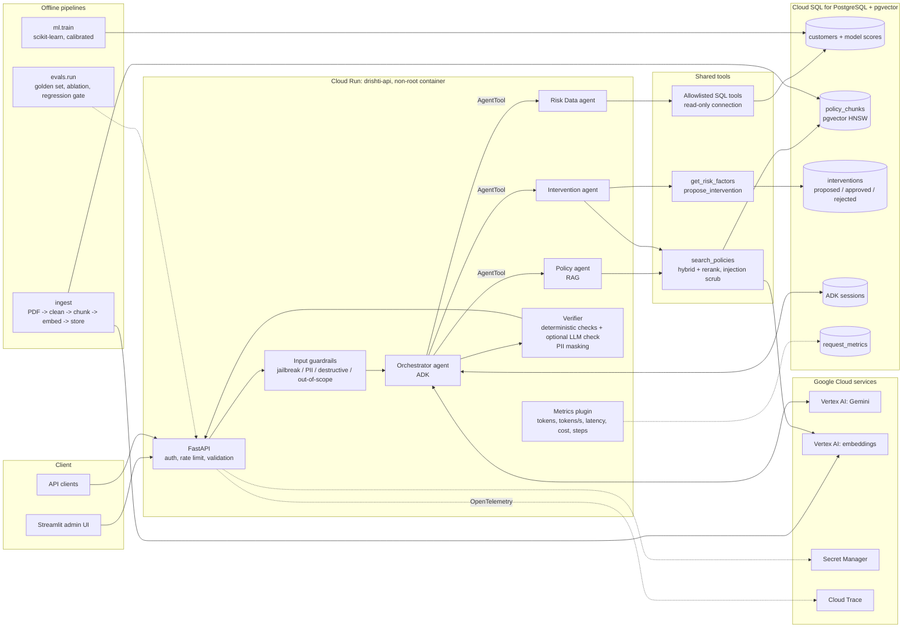

# Architecture

## System diagram

## Request flow (`POST /chat`)

1. **API layer**: API-key check (hashed keys) or IAP identity, rate limit, Pydantic validation.
2. **Input guardrails** (no LLM): jailbreak, bulk-PII, destructive and out-of-scope patterns are refused immediately. Zero tokens spent.
3. **Orchestrator** reads the conversation from the persistent ADK session, plans, and calls specialists as tools (hierarchical delegation). Each specialist runs its own reason → act → observe loop (ReAct).
4. **Tools** are the only way agents touch data:
   * *Risk Data*: a registry of seven named, parameterised queries over a read-only connection. No free-form SQL. The ground-truth label column is never selected.
   * *Policy*: `search_policies` returns passages with doc / section / clause / page / `chunk_id`, after scrubbing suspected prompt injection.
   * *Intervention*: `get_risk_factors`, and `propose_intervention`, the single write path. It only inserts `status = proposed`, rejects uncited actions, and rejects unknown chunk ids.
5. **Verifier** checks the final answer against the evidence gathered during the turn (citations must match retrieved passages; quoted numbers must appear in tool output), masks PII, and replaces an unverifiable answer with a safe fallback. An optional second LLM check (`LLM_VERIFIER=true`) can veto too.
6. **Response** carries `trace_id`, citations and per-request metrics. A PII-free metrics row is stored and logged as one JSON line.
7. **Humans decide**: `POST /interventions/{id}/decision` is the only way a recommendation becomes `approved`, recorded against the authenticated identity.

## Design decisions and trade-offs

| Decision | Why | Trade-off / alternative |
|---|---|---|
| **Google ADK** | First-party Gemini/Vertex integration, `AgentTool` delegation, `DatabaseSessionService`, OpenTelemetry built in, plugin hooks for metrics | Younger ecosystem than LangGraph, and API moves fast (pinned at 2.14.1). LangGraph would give finer control over graph state |
| **Specialists as `AgentTool`s, not transfer** | The orchestrator keeps the conversation and composes the final answer; specialists stay stateless and testable | Each delegation adds an LLM hop (latency + cost). The ablation exists to measure whether it is worth it |
| **pgvector on Cloud SQL, not a separate vector DB** | Customer data, sessions, interventions and vectors live in one transactional store: one backup, one IAM story, joins between vectors and metadata, minimal ops | A dedicated engine (Vertex Vector Search) scales further. At a policy corpus of thousands of chunks, pgvector is plenty |
| **Hybrid (vector + BM25, RRF) + rerank** | Regulatory text is full of exact terms (clause numbers, "penal charges") that dense embeddings blur; BM25 catches them; RRF needs no score calibration; reranking fixes ordering | More moving parts and extra latency. Vector-only is kept as the measured baseline. BM25 is in-memory (fine at this scale; use Postgres `tsvector` if the corpus grows large) |
| **Structure-aware chunking** | Citations need heading + clause number; fixed windows split a clause from its number | Heading detection is regex-based and tuned to RBI formatting; other document styles may need tuning |
| **Deterministic guardrails first, LLM second** | Cheap, auditable, testable, zero latency for obvious attacks | Pattern lists can be evaded. Mitigated by tool-level controls (allowlist, read-only role, no execute path), not by the patterns alone |
| **Read-only DB role + allowlist** | Defence in depth: even a compromised prompt cannot write or read ground-truth columns | Less flexible than text-to-SQL. Unsupported questions are declined (and are in the eval set as such) |
| **Human approval, no execution** | Lending actions are regulated and consequential | Slower than automation. It is the right default for a first deployment |
| **Calibrated gradient boosting** | Probabilities need to be meaningful for thresholds and segments | Calibrated on the validation split, so thresholds picked there are mildly optimistic. Test metrics are reported on untouched data |
| **Offline embedder + offline eval path** | The pipeline, tests and CI run with no credentials | Hash embeddings are weaker than Vertex ones, so retrieval numbers must be quoted with the embedder used (recorded in results) |

## Observability

* **Tracing**: ADK emits spans for agents, model calls and tools. We add a `chat.request` root span and HTTP instrumentation. Exporters: console (local), OTLP (Jaeger), Cloud Trace (`TRACE_EXPORTER=gcp`). A masking exporter scrubs PII in span attributes before export.
* **Metrics** per request: input/output tokens, tokens/sec (output tokens / time spent in LLM calls), latency, cost from `drishti/obs/pricing.json` (dated, with its source), agent steps, tool calls, retrieval calls. `GET /admin/metrics` reports p50/p95.

## Operations

* **Schema**: PostgreSQL schema lives in versioned SQL (`migrations/`, applied by `python -m drishti.db.migrate`); a test parses the SQL and fails if it drifts from the ORM models. The four-eyes rule and action/status enums are also enforced as database constraints.
* **Infrastructure**: `deploy/terraform/` declares Cloud Run (private), Cloud SQL, Secret Manager, Artifact Registry, a least-privilege service account and a budget alert. `deploy/deploy.sh` does the same with gcloud and also runs bootstrap jobs (migrate, load customers, ingest, first API key).
* **Credentials**: a drop-in `secrets/` folder (Gemini API key or service-account JSON) is auto-detected (`drishti/bootstrap.py`); the same code path uses Application Default Credentials on Cloud Run.
* **CI/CD**: PR checks (lint, types, tests, offline eval, pgvector integration on a Postgres service, Docker build + health, `terraform validate`, shellcheck, React lint + build); manual **eval** and **deploy** workflows.

## Known limitations

* The ML model scores a public card-default dataset (Taiwan, 2005), not a bank's portfolio. Its precision is far lower than a headline "94%": see `models/metrics.json`.
* Customer-level `risk_proba` for the 30,000 loaded rows includes rows the model was trained on, so ranking demos are in-sample. Evaluation metrics use the held-out test split only.
* SHAP values explain the raw (pre-calibration) score of the selected tree model. Calibration is monotonic, so the direction of each driver is unchanged, but magnitudes are in log-odds.
* The retrieval relevance metric is keyword-based (a proxy). The production embedder and reranker (Gemini) have not been measured until an LLM key is supplied.
* Corpus documents are web text without page numbers, so citations use chapter / topic / paragraph. PDFs, when added, carry page numbers.
* The pgvector store, migrations, Docker image and Terraform are verified by CI on GitHub rather than on the author's laptop (no Docker or Postgres was installed locally).
